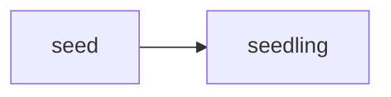

# Starting Seeds [#germination]

Growing plants from seed beats buying starts. Read the companion notes: [[Stratification]] and [[Cold-Frame|overwintering]]. This effort is tagged [[Tomatoes]] and [[Perennials]].

> [!note] Timing
> Sow **cool-season** crops right after the last frost date.

The viability curve follows $v(t) = e^{-kt}$:

$$\int_0^{t_0} e^{-kt}\,dt = \frac{1 - e^{-kt_0}}{k}$$

==Moisture is the hardest part.== %% keep the tray covered until first true leaves %%

## Cold stratification [#stratification]

| Crop     | Days cold | Notes                |
| -------- | --------- | -------------------- |
| Parsnip  | 21        | needs full three weeks |
| Tomato   | 0         | do not stratify      |

- [x] order trays
- [ ] ~~visit the nursery~~ call them instead

See [[Starting Seeds#stratification|stratification notes]] above, or alias-this same file as [[Germination|start here]]. Suppliers are listed in the workbook at [[/docs/seeds/price-list.xlsx]].

![[Garden/seedling.png]]

Literal brackets need escaping: \[\[not-a-link\]\].

[^1]: Sources: the local cooperative extension fact sheet, 2026 ed.